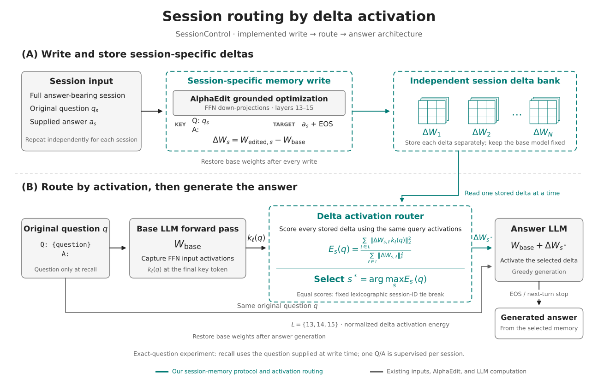

# SessionControl architecture



[SVG](figures/sessioncontrol-architecture.svg) · [PDF](figures/sessioncontrol-architecture.pdf) · [PNG](figures/sessioncontrol-architecture.png)

Teal identifies the session-specific memory protocol, independent delta bank, and activation router. Monochrome identifies inputs and existing AlphaEdit/LLM computation. The color identifies the system contribution; it does not claim that AlphaEdit itself is a new method.

In part A, each write receives the full answer-bearing session, original question, and supplied answer. AlphaEdit optimizes FFN layers 13–15 with the bare question key and the answer-plus-EOS target, using the full session as grounding. Each session's weight change is stored independently, and the base weights are restored after every write.

In part B, the base LLM captures the final-key-token FFN input activation for the original question. The router reads each stored delta separately and computes the sum of squared delta-induced activation changes, normalized by that delta's summed squared Frobenius norm across the three layers. It selects the largest score, resolving exact ties by lexicographic session ID. The selected delta is applied to the base LLM, which generates the answer to that same question and stops at EOS or a new conversation-turn delimiter. Base weights are restored afterward.

This depicts the implemented activation architecture. It does not generate a text candidate under every delta or use a BERT question–candidate scorer. The current experiment recalls the exact question supplied at write time and supervises one Q/A per session; grounding on a full session does not establish retention of every fact in that session.

Regenerate the three formats with the experiment environment:

```bash
python scripts/build_architecture_diagram.py
```
